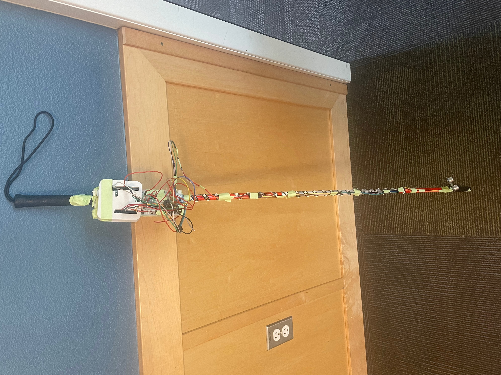

# BeepBeep

BeepBeep is an IoT device that utilizes four different sensors to
turn a white cane smart.

**Features:**
- Obstacle Detection
- Glow in the Dark
- GPS Tracking w/ Adafruit IO
- Fall Detection

